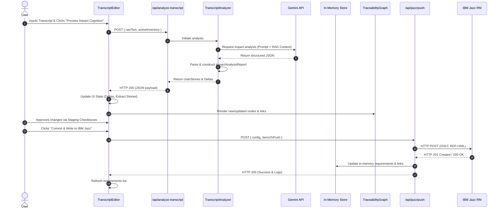
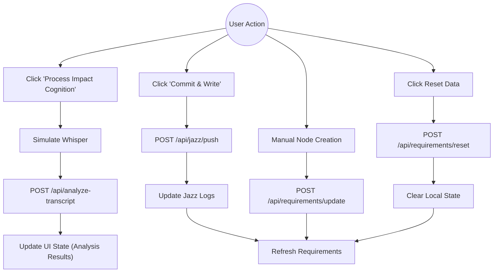

# Data Flow & State Management

## 1. Primary Data Flow

## 2. In-Memory Data Store Design

The application utilizes an intentional in-memory backend storage design for its MVP phase (as noted in ADR-0002).

*   `currentRequirements: Requirement[]`: A mutable array holding the authoritative list of requirements. Initialized on startup from a static `INITIAL_REQUIREMENTS` dataset. It is mutated by `/api/requirements/update`, `/api/jazz/push`, and `/api/requirements/reset`.
*   `currentLinks: TraceLink[]`: A mutable array holding requirement trace links. Initialized from `INITIAL_LINKS` and extended dynamically during push operations.
*   **Lifecycle**: Both data structures are created when the Node.js server starts. They are manipulated by REST API calls during the application's runtime. Because there is no persistent storage layer (e.g., PostgreSQL or MongoDB), all data modifications are lost when the server process is restarted.

## 3. Frontend State Architecture

The React application state is conceptually grouped into the following domains, managed primarily within the top-level `App` component.

### Connection State
*   `connections: ConnectionConfig` - Holds the configuration for IBM Jazz, Neo4j, n8n webhook, and the LLM model name.
*   `showConfig: boolean` - Controls the visibility of the configuration modal/panel.
*   `isApiKeyAvailable: boolean` - Indicates if the server reported a valid Gemini API key.

### Requirements Database State
*   `requirements: Requirement[]` - The local cache of requirements fetched from `/api/requirements`.
*   `links: TraceLink[]` - The local cache of trace links fetched from the server.
*   `isLoadingReqs: boolean` - UI loading flag for the initial data fetch.

### Pipeline Workflow State
*   `selectedTranscriptId: string` - The ID of the currently selected sample transcript (e.g., 'TR-01').
*   `customTranscriptText: string` - The current text content in the transcript editor.
*   `isWhisperTranscribing: boolean` - UI state simulating Whisper voice-to-text processing.
*   `isAnalyzing: boolean` - UI loading state during the Gemini API call.
*   `pipelineStep: number` - Tracks the user's progress through the 5-step pipeline (1-5).

### Analysis Result State
*   `extractedStories: UserStory[]` - Array of user stories extracted by the LLM.
*   `deltaUpdates: Array<{...}>` - Proposed modifications to existing requirements, containing target ID, reason, recommended text, and a `staged` boolean flag.
*   `deltaAdditions: Array<{...}>` - Proposed new requirements containing type, title, text, ASIL rating, trace targets, and a `staged` boolean flag.
*   `missingReqWarning: string` - Optional warning text from the LLM regarding missing safety parameters.

### UI Interaction State
*   `selectedEntityId: string` - The ID of the node currently selected in the graph (opens the detail drawer).
*   `showManualCreator: boolean` - Controls visibility of the manual requirement dialog.
*   `manualReq: Partial<Requirement>` - Holds the form state for manual requirement creation.

### Jazz Integration State
*   `isSyncingToJazz: boolean` - UI loading state during the OSLC push operation.
*   `jazzLogs: string[]` - Array of log messages detailing the OSLC XML generation and communication.
*   `jazzSuccess: boolean` - Flag indicating a successful push to IBM Jazz.
*   `reportDownloaded: boolean` - Tracks if the user has downloaded the final impact report.

## 4. Event Flow Diagram

## 5. Graph Rendering Pipeline

The traceability graph provides an interactive visual representation of the application state. The rendering pipeline operates as follows:

1.  **Node Computation**: The `visibleNodes[]` array is dynamically derived by combining the baseline `requirements` array with the `extractedStories` and `deltaAdditions` (if they are staged).
2.  **Node Positioning**: Nodes are laid out systematically. Y-coordinates are assigned based on the node type to create a layered architecture:
    *   `Stories`: Y=25
    *   `SystemReq`: Y=100
    *   `SoftwareReq`: Y=190
    *   `TestCase`: Y=280
    X-coordinates are evenly distributed across the available SVG width within each layer.
3.  **Link Rendering**: Connections are drawn by iterating over the baseline `TraceLink[]` array. Furthermore, dynamic links are established on-the-fly to connect newly extracted stories to new requirement additions based on the analysis results.
4.  **Impact Highlighting**: To visualize the impact analysis, the system maintains sets of `updatedIds` and `addedIds`. When rendering the SVG elements, nodes matching these IDs receive distinct styling (e.g., border color changes, glow effects) and CSS animations to draw user attention to the deltas.
