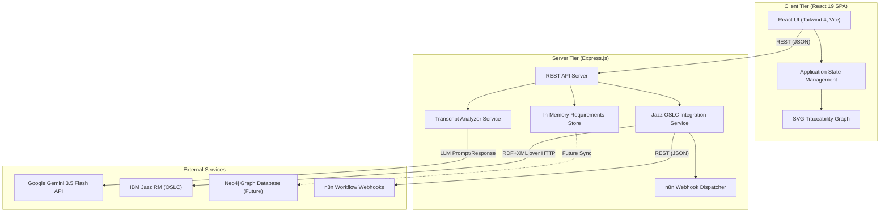
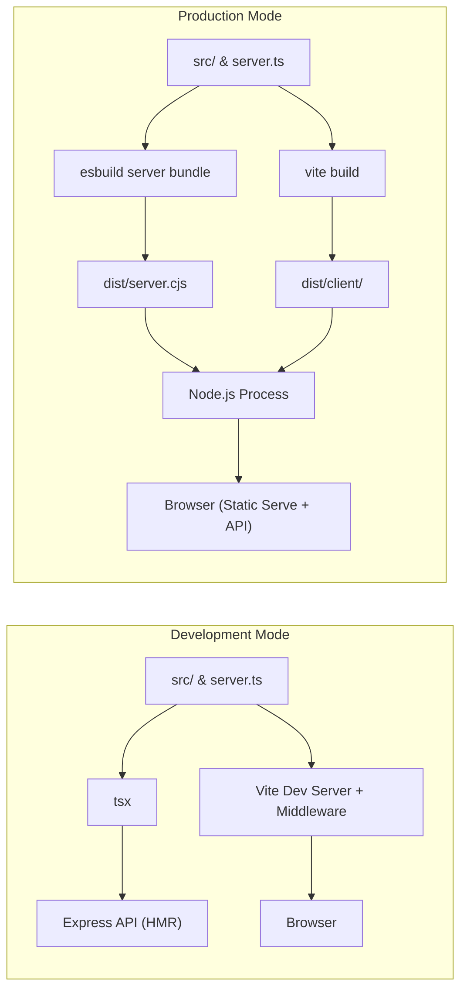

# System Architecture

## 1. High-Level Architecture Diagram

## 2. Component Decomposition

### Frontend Components
Currently contained within a single `App.tsx` file (1406 lines), the frontend is logically divided into these main regions:

*   **AppHeader**: Displays application title, integration status indicators (Whisper, Jazz, Neo4j, n8n), and a configuration trigger button.
*   **PipelineSidebar**: Manages the 5-step analysis pipeline tracker, allows selection of sprint workshop transcripts, manages the RAG contexts checklist, and displays Neo4j stats.
*   **TranscriptEditor**: Provides an editable textarea for the meeting transcript input, includes a character counter, and displays Whisper simulated status.
*   **DeltaAnalysisPanel**: Displays extracted user stories, requirement update recommendations, and new requirement suggestion cards. Includes staging checkboxes for user approval.
*   **TraceabilityGraph**: An SVG-based dynamic graph visualization. Renders nodes (Story, SystemReq, SoftwareReq, TestCase), directional links, ASIL badges, and provides an interactive selection drawer for detailed viewing.
*   **StagingPanel**: Manages the IBM Jazz write-back queue. Features an OSLC XML log viewer, connection configuration form, and a report download action.
*   **ManualRequirementDialog**: A modal form for the manual creation and insertion of requirements into the system.

### Backend Services
Currently contained within `server.ts` (365 lines), the backend provides the following specific services:

*   **HealthService**: Handles `GET /api/health` to confirm server status and API key availability.
*   **RequirementsStore**: Provides in-memory CRUD operations for requirements and trace links.
*   **TranscriptAnalyzer**: Manages integration with the Gemini LLM. Wraps prompts with context and ISO 26262 guidelines, parses the structured JSON output, and computes impact analysis.
*   **JazzIntegrationService**: Constructs OSLC RDF+XML payloads. Dispatches HTTP requests to the target Jazz server or falls back to sandbox simulation if a real server is unreachable.
*   **WebhookService**: Dispatches notifications to configured n8n webhooks upon key lifecycle events (e.g., successful Jazz push).

## 3. Deployment Architecture

## 4. Technology Stack Table

| Category | Technology | Version | Purpose |
| :--- | :--- | :--- | :--- |
| **Frontend Framework** | React | 19.x | Component-based UI rendering, state management. |
| **Language** | TypeScript | 5.x | Type safety across frontend and backend tiers. |
| **Styling** | Tailwind CSS | 4.x | Utility-first CSS for rapid, consistent UI design. |
| **Build Tool** | Vite | 6.x | Fast development server, HMR, and optimized production build. |
| **Icons** | Lucide React | Latest | Consistent, clean SVG iconography across the application. |
| **Animation** | Motion | Latest | Smooth transitions and layout animations. |
| **Backend Framework** | Express.js | 4.x | Lightweight HTTP server and API routing. |
| **AI Integration** | @google/genai | Latest | Google SDK for communicating with the Gemini 3.5 Flash model. |
| **Server Bundler** | esbuild | Latest | Fast TypeScript transpilation and bundling for the Express server. |

## 5. Security Considerations

*   **API Key Management**: The Google Gemini API key is managed exclusively via the `GEMINI_API_KEY` environment variable on the server. It is never exposed to the client. The frontend queries `/api/health` to verify its presence.
*   **IBM Jazz Credential Handling**: Credentials (URL, username, password) are collected in the client configuration panel and passed to the backend per request. While in memory on the frontend, passwords are masked in the UI. In a production environment, HTTPS is required to secure the transmission of these credentials.
*   **OSLC Endpoint Validation**: The server enforces basic structural validation on the OSLC XML payloads and target URLs to prevent malformed requests.
*   **AbortSignal Timeouts**: Calls to external services (Gemini, IBM Jazz, n8n) are wrapped with `AbortSignal` timeouts to prevent hanging requests from blocking the Node.js event loop.
